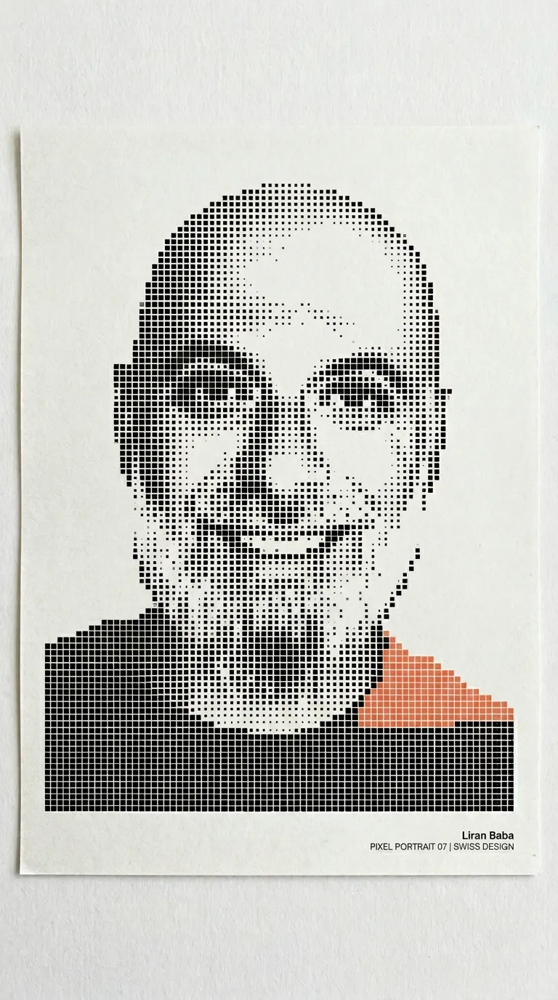

```
 █      █████  █████    ██   ██   █
 █        █    █   ▓█   ██   ██░  █
 █        █    █    █  ▒██▒  █▒▓  █
 █        █    █   ▒█  ▓▒▒▓  █ █  █
 █        █    █████   █░░█  █ ▓▓ █
 █        █    █  ░█▒  █  █  █  █ █
 █        █    █   ░█ ▒████▒ █  ▓▒█
 █        █    █    █ ▓▒  ▒▓ █  ░██
 ██████ █████  █    ▒ █░  ░█ █   ██

 █████░   ██   █████░   ██
 █   ▒█   ██   █   ▒█   ██
 █    █  ▒██▒  █    █  ▒██▒
 █   ▒█  ▓▒▒▓  █   ▒█  ▓▒▒▓
 █████░  █░░█  █████░  █░░█
 █   ▒█  █  █  █   ▒█  █  █
 █    █ ▒████▒ █    █ ▒████▒
 █   ▒█ ▓▒  ▒▓ █   ▒█ ▓▒  ▒▓
 █████░ █░  ░█ █████░ █░  ░█
```

AI Lead at JFrog. 18 years in enterprise software.

I build AI tooling for developers. The best version of these tools is the one you stop noticing.

---

### Projects

| | |
|---|---|
| [Claudoscope](https://github.com/cordwainersmith/Claudoscope) | macOS dashboard for your Claude Code sessions |
| [GolemPII-v1](https://huggingface.co/CordwainerSmith/GolemPII-v1) | Hebrew PII detection model, trained on 115K examples |
| [Adapt-CV](https://huggingface.co/spaces/CordwainerSmith/adapt-cv) | Aligns your resume to a job description so ATS stops throwing it out |
| [GolemGuard](https://huggingface.co/datasets/CordwainerSmith/GolemGuard) | 115K Hebrew samples for training PII detection models |
| [CustomerPersonas](https://huggingface.co/datasets/CordwainerSmith/CustomerPersonas) | 250K synthetic customer personas across six industries |
| [alpharalpha.dev](https://liranbaba.dev) | Blog. Mostly AI and dev tools. |

---

[alpharalpha.dev](https://liranbaba.dev) / [rss](https://liranbaba.dev/rss.xml)
# cordwainersmith
