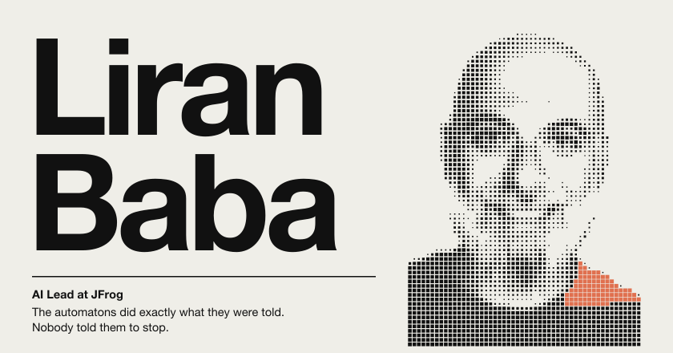
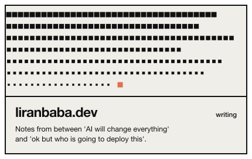
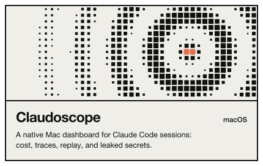
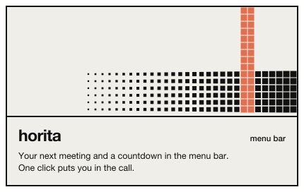
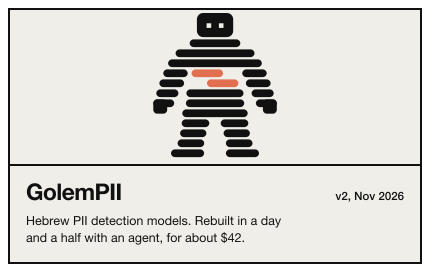
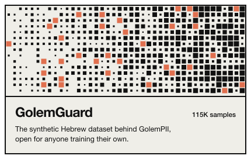
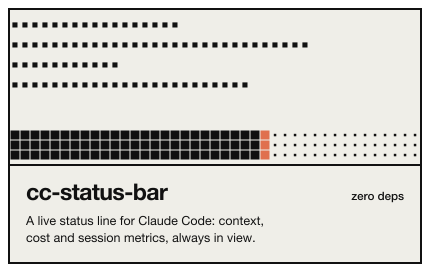

<picture>
  <source media="(prefers-color-scheme: dark)" srcset="assets/hero-dark.svg" />
  
</picture>

<a href="https://liranbaba.dev"><picture><source media="(prefers-color-scheme: dark)" srcset="assets/blog-dark.svg" /></picture></a>
<a href="https://github.com/cordwainersmith/Claudoscope"><picture><source media="(prefers-color-scheme: dark)" srcset="assets/claudoscope-dark.svg" /></picture></a>
<a href="https://github.com/cordwainersmith/horita"><picture><source media="(prefers-color-scheme: dark)" srcset="assets/horita-dark.svg" /></picture></a>
<a href="https://huggingface.co/CordwainerSmith/GolemPII-v2-base"><picture><source media="(prefers-color-scheme: dark)" srcset="assets/golempii-dark.svg" /></picture></a>
<a href="https://huggingface.co/datasets/CordwainerSmith/GolemGuard"><picture><source media="(prefers-color-scheme: dark)" srcset="assets/golemguard-dark.svg" /></picture></a>
<a href="https://github.com/cordwainersmith/cc-status-bar"><picture><source media="(prefers-color-scheme: dark)" srcset="assets/cc-status-bar-dark.svg" /></picture></a>

Also: [Adapt-CV](https://huggingface.co/spaces/CordwainerSmith/adapt-cv), [CustomerPersonas](https://huggingface.co/datasets/CordwainerSmith/CustomerPersonas), [reddit-mcp](https://github.com/cordwainersmith/reddit-mcp). Writing at [liranbaba.dev](https://liranbaba.dev) ([rss](https://liranbaba.dev/rss.xml)).
